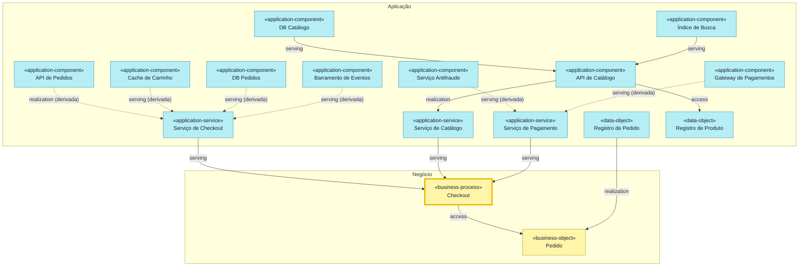
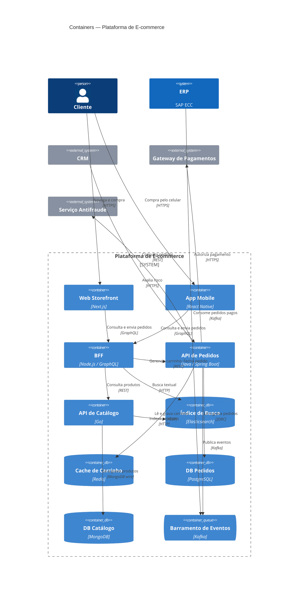

# archlens-ask — exemplos resolvidos

Quatro perguntas sobre a base de exemplo `loja-online` (prefixo `archlens/`), com o caminho completo: recorte,
chamadas, raciocínio e resposta. Os elementos e as relações de cada resposta são os mesmos que a `archlens-query`
devolve para o mesmo recorte.

---

## Exemplo 1 — "Que aplicações e infraestrutura sustentam o processo de checkout?"

**Recorte** (`RULES.md` §1, "aplicações e infra por trás do processo Q"):
`{"notation":"archimate","viewpoint":"layered","anchor":"bp-checkout","traverse":{"mode":"supporters"},"granularity":"container"}`

**Chamadas, na ordem:**
1. `list_pages {"type":"archlens-manifest"}` → acha `archlens/manifest` (uma base; o bloco `archlens-json` diz
   formato `2.0`).
2. `resolve_slugs {"partial":"checkout"}` / `search {"query":"checkout"}` → o processo `archlens/business-process/bp-checkout`
   (título "Checkout"). Os outros resultados (`as-checkout`, `loja.pedidos.checkout`) são de outros tipos, e o pedido
   fala de **processo**: não há ambiguidade.
3. `get_backlinks {"slug":"archlens/business-process/bp-checkout"}` → com ligações tipadas, os backlinks `serving` de
   `as-checkout`, `as-catalogo` e `as-pagamento` (ignore os `mentions`).
4. `get_page` de `bp-checkout`: tem `access → bo-pedido`. Em `access`, **o dado sustenta quem o acessa**
   (`REFERENCE.md`), então `bo-pedido` entra como suporte.
5. Siga a busca em largura (`RULES.md` §3), com `get_backlinks` + `get_page` a cada salto:
   - distância 1: `as-checkout`, `as-catalogo`, `as-pagamento`, `bo-pedido`;
   - distância 2: `loja.catalogo` (realiza `as-catalogo`), `do-pedido` (realiza `bo-pedido`), o componente
     `loja.pedidos.checkout` (realiza `as-checkout`) e o componente `loja.pedidos.pagamento` (realiza `as-pagamento`);
   - distância 3: `loja.pedidos` (pai de `loja.pedidos.checkout`, subida pela hierarquia), `gateway` e `antifraude`
     (servem `loja.pedidos.pagamento`), `loja.busca` e `loja.db-catalogo` (servem `loja.catalogo`), `do-produto`
     (acessado por `loja.catalogo`), `ts-hosting`, `ss-mongo`, `ss-elastic`;
   - distância 4 em diante: `loja.cache`, `loja.db-pedidos` e `loja.eventos` (servem componentes de `loja.pedidos`),
     `tn-k8s`, `ts-mensageria`, `ss-postgres`, `ss-redis`, `art-pedidos`; depois `ss-kafka`.
6. **Granularidade `container`:** os componentes `loja.pedidos.*` somem. As cadeias que passavam por eles viram
   relações **derivadas** (`RULES.md` §4). Exemplo: `loja.cache serving loja.pedidos.carrinho`,
   `loja.pedidos.carrinho serving loja.pedidos.checkout` e `loja.pedidos.checkout realization as-checkout` viram
   `loja.cache serving as-checkout`, derivada via Carrinho Service e Checkout Controller (o mais fraco entre serving,
   serving e realization é `serving`).

São 25 elementos, acima de ~24 (`RULES.md` §10). O markdown sai completo e o diagrama mostra só negócio e
aplicação; a tecnologia fica na tabela.

**Resposta:**

> Recorte: `{"notation":"archimate","viewpoint":"layered","anchor":"bp-checkout","traverse":{"mode":"supporters"},"granularity":"container"}`
>
> # Visão em Camadas — Checkout
>
> ## Negócio
>
> | Nome | Tipo | Status | Tecnologia |
> |---|---|---|---|
> | Checkout | business-process | active |  |
> | Pedido | business-object | active |  |
>
> ## Aplicação
>
> | Nome | Tipo | Status | Tecnologia |
> |---|---|---|---|
> | API de Pedidos | application-component (container) | active | Java / Spring Boot |
> | API de Catálogo | application-component (container) | active | Go |
> | Índice de Busca | application-component (container) | active | Elasticsearch |
> | Cache de Carrinho | application-component (container) | active | Redis |
> | DB Pedidos | application-component (container) | active | PostgreSQL |
> | DB Catálogo | application-component (container) | active | MongoDB |
> | Barramento de Eventos | application-component (container) | active | Kafka |
> | Gateway de Pagamentos | application-component (softwareSystem) | active |  |
> | Serviço Antifraude | application-component (softwareSystem) | active |  |
> | Serviço de Checkout | application-service | active |  |
> | Serviço de Catálogo | application-service | active |  |
> | Serviço de Pagamento | application-service | active |  |
> | Registro de Pedido | data-object | active |  |
> | Registro de Produto | data-object | active |  |
>
> ## Tecnologia
>
> | Nome | Tipo | Status | Tecnologia |
> |---|---|---|---|
> | Cluster Kubernetes (EKS) | node | active |  |
> | Hospedagem de contêineres | technology-service | active |  |
> | Mensageria | technology-service | active |  |
> | PostgreSQL 16 (RDS) | system-software | active |  |
> | MongoDB Atlas | system-software | active |  |
> | Redis (ElastiCache) | system-software | active |  |
> | Apache Kafka (MSK) | system-software | active |  |
> | Elasticsearch | system-software | active |  |
> | pedidos-api.jar | artifact | active |  |
>
> ## Relações
>
> - Serviço de Checkout serve Checkout. (serving)
> - Serviço de Catálogo serve Checkout. (serving)
> - Serviço de Pagamento serve Checkout. (serving)
> - Checkout grava Pedido. (access)
> - Registro de Pedido realiza Pedido. (realization)
> - API de Catálogo realiza Serviço de Catálogo. (realization)
> - API de Catálogo lê e grava Registro de Produto. (access)
> - DB Catálogo serve API de Catálogo. (serving)
> - Índice de Busca serve API de Catálogo. (serving)
> - Hospedagem de contêineres serve API de Pedidos. (serving)
> - Hospedagem de contêineres serve API de Catálogo. (serving)
> - Cluster Kubernetes (EKS) realiza Hospedagem de contêineres. (realization)
> - Apache Kafka (MSK) realiza Mensageria. (realization)
> - Mensageria serve API de Pedidos. (serving)
> - PostgreSQL 16 (RDS) serve API de Pedidos. (serving)
> - Redis (ElastiCache) serve API de Pedidos. (serving)
> - MongoDB Atlas serve API de Catálogo. (serving)
> - Elasticsearch serve API de Catálogo. (serving)
> - pedidos-api.jar realiza API de Pedidos. (realization)
> - pedidos-api.jar roda em Cluster Kubernetes (EKS). (assignment)
> - API de Pedidos realiza Serviço de Checkout. (realization, derivada via Checkout Controller)
> - Serviço Antifraude serve Serviço de Pagamento. (serving, derivada via Pagamento Adapter)
> - Gateway de Pagamentos serve Serviço de Pagamento. (serving, derivada via Pagamento Adapter)
> - Cache de Carrinho serve Serviço de Checkout. (serving, derivada via Carrinho Service, Checkout Controller)
> - DB Pedidos serve Serviço de Checkout. (serving, derivada via Pedido Repository, Checkout Controller)
> - Barramento de Eventos serve Serviço de Checkout. (serving, derivada via Publicador de Eventos, Checkout Controller)
>
> O diagrama abaixo mostra negócio e aplicação (16 elementos); os 9 de tecnologia estão na tabela acima.

---

## Exemplo 2 — "O que é impactado se a API de Pedidos cair?"

**Recorte** (`RULES.md` §1, "impacto se A falhar"):
`{"notation":"archimate","viewpoint":"impact","anchor":"loja.pedidos"}`. Em `impact`, o modo padrão é `both`, `via`
inclui `flow` e a granularidade padrão é `container` (`RULES.md` §3–§4).

**Chamadas e raciocínio:**
1. `resolve_slugs`/`search` "API de Pedidos" → `archlens/application-component/loja.pedidos` (único).
2. **Dependents** (o que a API sustenta), saindo das relações **de saída** da âncora e dos filhos dela:
   - `get_page loja.pedidos`: `realization → as-consulta`, `realization → req-latencia`, `serving → crm`;
   - filhos (hierarquia: `get_backlinks` com `part_of`, ou o `parent` das páginas): `loja.pedidos.checkout`,
     `.carrinho`, `.pagamento`, `.repo`, `.eventos`. Cada um entra com distância 1 e papel "ambos", porque a parte
     sustenta o todo e o todo é composto da parte;
   - a partir daí: `loja.pedidos.checkout realization as-checkout` → `as-checkout serving bp-checkout` →
     `bp-checkout realization bs-compra` → … até o produto `prod-venda`, o ator `cliente` e o papel `br-comprador`.
3. **Supporters** (o que a API precisa), pelas relações **de entrada** e pelo `access`:
   - `ts-hosting`, `ts-mensageria`, `ss-postgres`, `ss-redis` servem `loja.pedidos`; `art-pedidos` realiza;
   - `loja.pedidos.repo access do-pedido`: em `access`, **o dado sustenta quem acessa**, então `do-pedido` é
     *suporte* (não dependente), à distância 2;
   - `loja.cache`, `loja.db-pedidos`, `loja.eventos`, `gateway`, `antifraude` servem os componentes.
4. 32 elementos visíveis, acima de ~24: entregue o markdown com a matriz e ofereça um diagrama recortado.

**Resposta** (trecho; a resposta real traz todas as linhas):

> Recorte: `{"notation":"archimate","viewpoint":"impact","anchor":"loja.pedidos"}`
>
> # Matriz de Impacto — API de Pedidos
>
> *(tabelas por camada: Motivação, Negócio, Aplicação, Tecnologia)*
>
> ## Matriz de dependência
>
> | Elemento | Tipo | Camada | Relação | Dist. | Caminho |
> |---|---|---|---|---|---|
> | Checkout < 2s (p95) | Requirement | Motivação | depende | 1 | realization → Checkout < 2s (p95) |
> | Atendente SAC | Business Actor | Negócio | depende | 2 | serving → CRM · serving → Atendente SAC |
> | Checkout | Business Process | Negócio | depende | 3 | composition → Checkout Controller · realization → Serviço de Checkout · serving → Checkout |
> | Venda Online | Product | Negócio | depende | 4 | serving → CRM · serving → Tratar solicitação · realization → Atendimento pós-venda · aggregation → Venda Online |
> | CRM | Application Component | Aplicação | depende | 1 | serving → CRM |
> | Hospedagem de contêineres | Technology Service | Tecnologia | sustenta | 1 | serving → Hospedagem de contêineres |
> | Checkout Controller (oculto na visão) | Application Component | Aplicação | ambos | 1 | composition → Checkout Controller |
> | Registro de Pedido | Data Object | Aplicação | sustenta | 2 | composition → Pedido Repository · access → Registro de Pedido |
> | Cluster Kubernetes (EKS) | Node | Tecnologia | sustenta | 2 | serving → Hospedagem de contêineres · realization → Cluster Kubernetes (EKS) |
>
> Relações derivadas pelos componentes ocultos: Cache de Carrinho, DB Pedidos, Barramento de Eventos, Gateway de
> Pagamentos e Serviço Antifraude **servem** a API de Pedidos (via o componente que os usa); a API de Pedidos
> **acessa** Registro de Pedido (via Pedido Repository), **serve** o BFF (via Checkout Controller) e **realiza**
> Serviço de Checkout e Serviço de Pagamento.
>
> São 32 elementos: quer um diagrama só com o que **depende** da API (negócio e aplicação), ou só com o que ela
> **precisa** (aplicação e tecnologia)?

---

## Exemplo 3 — "Desenhe os containers da loja" (só diagrama, C4)

**Recorte:** a visão salva `containers` bate com o pedido. `get_page archlens/views/containers` → bloco
`archlens-json` com `{"notation":"c4","level":"container","scope":"loja"}`.

**Raciocínio:**
- `scope` `loja` (sistema): abre a fronteira; os containers são os filhos com `c4: container` (via `part_of`, ou o
  `parent` das páginas `archlens/c4/container`).
- Setas C4 (`RULES.md` §5): `serving` A → B vira **B usa A**. Na página de `loja.pedidos` há `serving → crm` ("API
  de Pedidos serve CRM"), que no C4 vira `crm → loja.pedidos` ("CRM usa API de Pedidos"). As relações dos componentes
  sobem ao container: `loja.pedidos.carrinho serving loja.bff` vira "BFF usa API de Pedidos".
- Duas relações do BFF para a API de Pedidos (vindas de componentes diferentes) viram uma: "Gerencia carrinho; Fecha
  pedido".
- Tags `database` → `ContainerDb`; `queue` → `ContainerQueue`; `external: true` → `System_Ext`.
- 15 elementos, um pouco acima de ~12: o pedido é exatamente esta visão salva, então vale a exceção de
  `RULES.md` §10: desenhe inteira e avise que está no limite.

> Recorte: `{"notation":"c4","level":"container","scope":"loja"}` (visão salva `containers`). São 15 elementos, no
> limite da leitura; para menos, peça o foco num container (ex.: "focando na API de Pedidos").

---

## Exemplo 4 — "Me fale da API de Pedidos" (só markdown)

**Recorte:** cartão do elemento `loja.pedidos` (`RULES.md` §7).

**Chamadas:** `get_page archlens/application-component/loja.pedidos` (identidade, `parent`, relações de saída);
`get_backlinks` dela (relações de entrada e filhos, confirmados com `get_page` de cada candidata);
`get_page archlens/changelog` (rodadas que citam o id).

**Resposta:**

> # API de Pedidos
>
> - Id: `loja.pedidos`
> - Tipo: application-component (perfil C4: container)
> - Status: active
> - Tecnologia: Java / Spring Boot
>
> Carrinho, checkout e ciclo de vida do pedido
>
> Pai: Plataforma de E-commerce (`loja`)
>
> ## Filhos
>
> - Checkout Controller (`loja.pedidos.checkout`)
> - Carrinho Service (`loja.pedidos.carrinho`)
> - Pagamento Adapter (`loja.pedidos.pagamento`)
> - Pedido Repository (`loja.pedidos.repo`)
> - Publicador de Eventos (`loja.pedidos.eventos`)
>
> ## Relações de saída
>
> ### realization
>
> - API de Pedidos realiza Consulta de Pedidos.
> - API de Pedidos atende a Checkout < 2s (p95).
>
> ### serving
>
> - API de Pedidos serve CRM. [REST]
>
> ## Relações de entrada
>
> ### realization
>
> - pedidos-api.jar realiza API de Pedidos.
>
> ### serving
>
> - PostgreSQL 16 (RDS) serve API de Pedidos.
> - Redis (ElastiCache) serve API de Pedidos.
> - Hospedagem de contêineres serve API de Pedidos.
> - Mensageria serve API de Pedidos.
