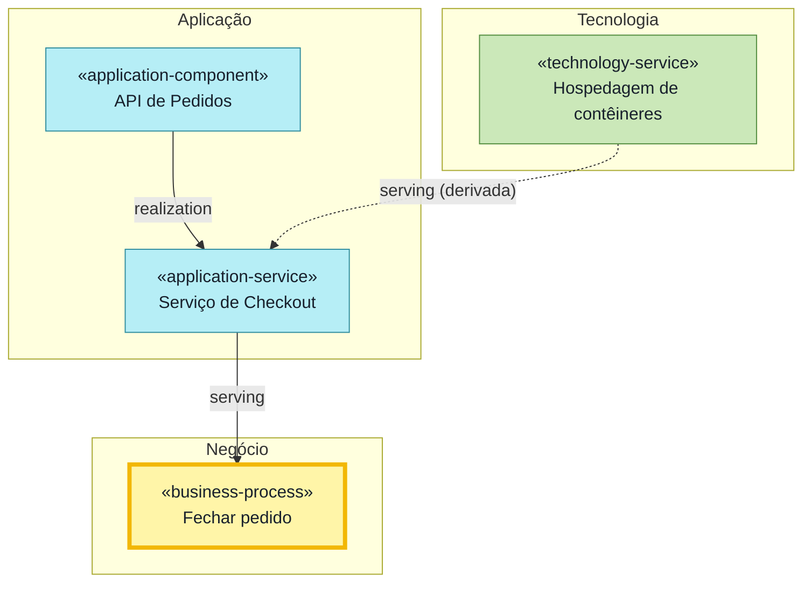
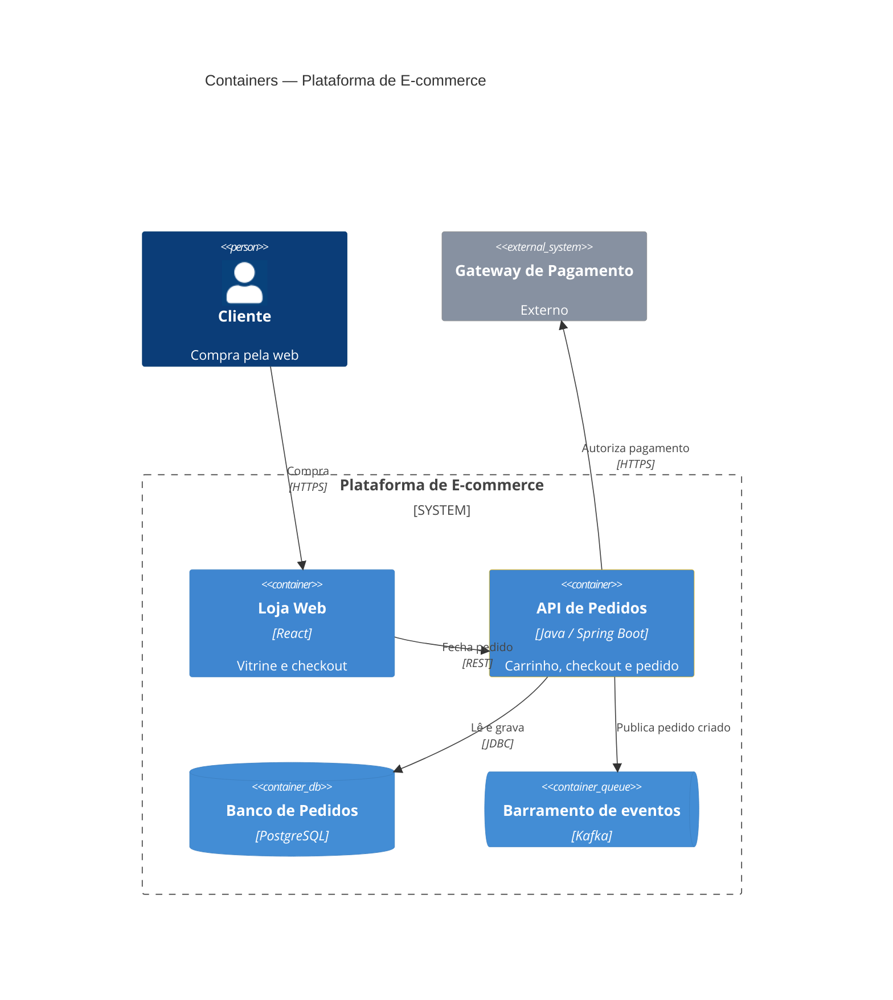
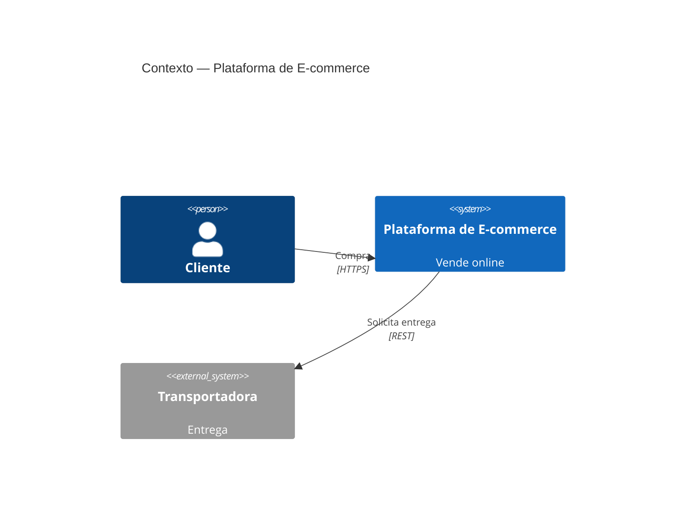
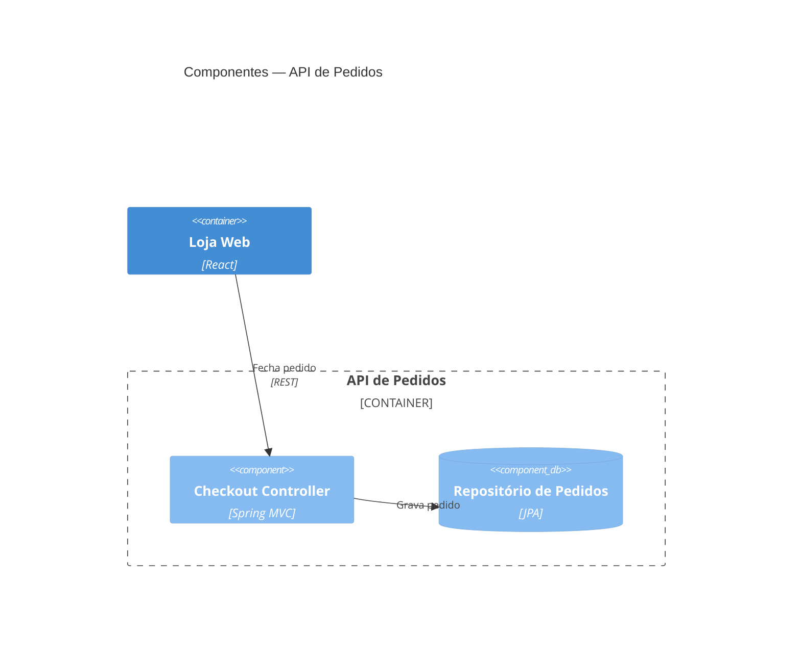
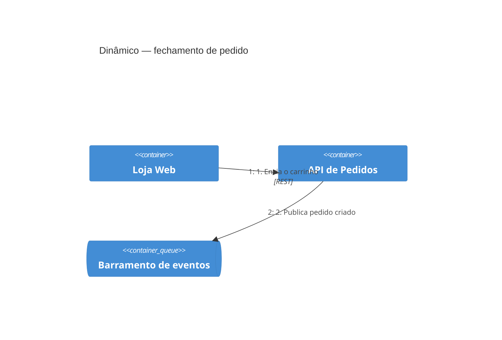
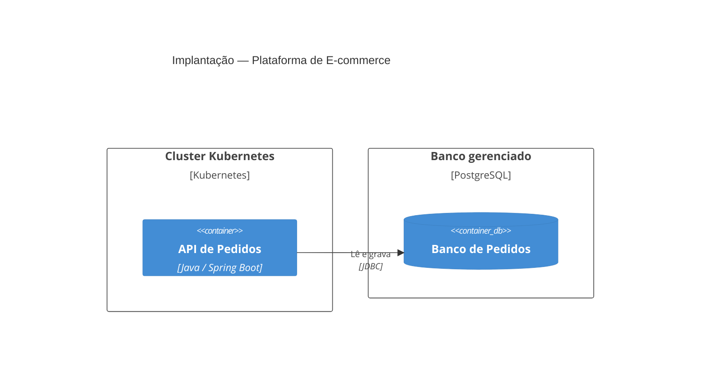

# archlens-ask — regras

Regras que reproduzem a `archlens-query` do archlens completo. Vocabulário, direção de suporte por relação e cores:
`REFERENCE.md`.

## 1. Pedido → recorte

Traduza o pedido num **recorte**: o mesmo JSON que a `archlens-query` chamaria de view spec. Ele aparece na linha
`Recorte:` da resposta.

| O usuário pede | Recorte |
|---|---|
| panorama de todos os sistemas | `{notation:"c4", level:"landscape"}` |
| contexto do sistema X | `{notation:"c4", level:"context", scope:"X"}` |
| containers de X | `{notation:"c4", level:"container", scope:"X"}` |
| …focando em Y (e vizinhos) | acrescente `focus:["Y"], depth:1` |
| componentes do container C | `{notation:"c4", level:"component", scope:"C"}` |
| fluxo / sequência de uma operação | `{notation:"c4", level:"dynamic", scope:"X ou C", steps:[{from,to,description}]}` |
| implantação / onde roda | `{notation:"archimate", viewpoint:"implementation-deployment"}` (diagrama em `C4Deployment`) |
| camada de negócio / aplicação / tecnologia | `{notation:"archimate", viewpoint:"business" \| "application" \| "technology"}` |
| estratégia, motivação, migração | `viewpoint:"strategy"`, `"motivation"`, `"implementation-migration"` |
| como as aplicações cooperam | `{notation:"archimate", viewpoint:"application-cooperation"}` |
| tudo que sustenta a oferta/produto P | `{notation:"archimate", viewpoint:"product-support", anchor:"P"}` |
| aplicações e infra por trás do processo Q | `{notation:"archimate", viewpoint:"layered", anchor:"Q", traverse:{mode:"supporters"}, granularity:"container"}` |
| o que depende de A / impacto se A falhar / matriz | `{notation:"archimate", viewpoint:"impact", anchor:"A"}` |
| quem consome / publica o evento ou tópico E | C4: `{notation:"c4", level:"container", scope:"<sistema de E>", focus:["E"], depth:1}`; ArchiMate: `viewpoint:"impact", anchor:"E"` |
| negócio × tecnologia sem a camada do meio | `{notation:"archimate", viewpoint:"custom", layers:["business","technology"], anchor:"P", derive:true}` |
| panorama com as plataformas / agrupamentos | `{notation:"c4", level:"landscape", groups:{frames:true}}` |
| interações entre os sistemas de A e de B | acrescente `groups:{only:["A","B"]}` (molduras aparecem sozinhas) |
| só o que cruza entre A e B | `groups:{only:["A","B"], crossOnly:true}` |
| containers dentro do sistema, "caixas dentro de caixas" (ArchiMate) | acrescente `nesting:"nested"` (ou `nesting:{mode:"nested", depth:1}`) |
| C4 sem as setas derivadas por serviços e interfaces | acrescente `derive:false` |
| como está hoje (as-is) | acrescente `status:["active","deprecated"]` |
| como fica depois das mudanças (to-be) | acrescente `status:["draft","planned","active"]` (sem `draft` para só o decidido) |
| me fale do elemento X | cartão do elemento (§7) |

Todo recorte tem `notation` (`"c4"` ou `"archimate"`); C4 usa `level`, ArchiMate usa `viewpoint`.
Outros campos do recorte: `key` e `title` (nome e título; numa visão salva, use os dela), `description`, `include`
(ids forçados), `exclude` (`"<id>"`, `"tag:<tag>"`, `"type:<tipo ou kind C4>"`, `"layer:<camada>"`, `"external"`),
`layers` (sobrescreve as camadas do viewpoint), `types` (só esses tipos ArchiMate), `collapse`, `output`
(`["diagram","matrix"]` acrescenta a matriz). Campos de apresentação do archlens não se aplicam ao Mermaid e são
ignorados: `layout` (e `layout.style`), `animation`, `edgeLabels`.

**Visões salvas.** As páginas `<prefixo>/views/<key>` guardam a spec num bloco `archlens-json`. Se o pedido cita
uma visão pelo título ou bate com uma delas (mesma âncora e intenção), use a spec dela. Se você ajustar algum campo a
pedido do usuário, tire a `key` e dê um `title` novo que descreva o recorte ajustado; sem ajuste, mantenha os dela.

**Camadas por viewpoint.** `business` → negócio; `application` e `application-cooperation` → aplicação;
`technology` → tecnologia e física; `strategy`, `motivation`, `implementation-migration` → a camada de mesmo nome
(implementação); `implementation-deployment` → aplicação, tecnologia e física; `product-support` → estratégia,
negócio, aplicação, tecnologia e física; `layered`, `impact` e `custom` → todas.

## 2. Leitura no gbrain

**Achar elementos.** `resolve_slugs` com o nome, `search` por texto, ou `list_pages` com a tag `archlens/<tipo>`. O
slug de um elemento é `<prefixo>/<tipo>/<id>` (ex.: `archlens/application-component/loja.pedidos`).

**Relações de saída de X:** o `relationships` da página de X (`to` é o id; o slug está no wikilink do campo do mesmo
tipo). **De entrada:** `get_backlinks(X)`. Com ligações tipadas, cada backlink tipado (`link_source: "frontmatter"`)
já dá o tipo e a direção (origem `from_slug` → X); leia a página de origem quando precisar da descrição ou da
tecnologia da relação. Ignore os backlinks `mentions` quando há ligações tipadas. Sem elas, os backlinks são só
`mentions`: confirme cada um no `relationships` da página de origem (item com `to: X`).

**Status:** campo `status` do frontmatter; **ausente significa `active`**.

**Reaproveite** as páginas já lidas na mesma conversa; releia só se o usuário disser que a base mudou.

**Hierarquia:** `parent` no frontmatter (filho → pai, wikilink). Os filhos de X são as páginas cujo `parent` aponta
para X. **Grupo:** `group` no frontmatter; a página do `grouping` não lista os membros.

**Modo de ligações.** Descubra uma vez por conversa. Pegue um elemento com `parent` e chame `get_backlinks` (ou
`traverse_graph` com direção de entrada) no pai:
- **com ligações tipadas** (o filho aparece, com ligação `part_of`): base no modo git ou com `gbrain sweep`. Use
  `get_backlinks`/`traverse_graph` para achar filhos (`part_of`) e membros de grupo (`member_of`);
- **degradado** (o filho não aparece): avise uma vez: "a base não tem as ligações tipadas no gbrain; o modo
  recomendado é o git ou rodar `gbrain sweep`; hierarquia e grupos podem sair incompletos". As relações de entrada
  ainda aparecem pelos backlinks do corpo das páginas (ligação `mentions`). Para filhos e membros de grupo, liste as
  páginas candidatas com `list_pages` (tag `archlens/<tipo>`: para filhos de um sistema ou container,
  `archlens/application-component`; para membros de grupo, todos os tipos) e confira `parent`/`group` com
  `get_page`. Antes de ler mais de ~30 páginas, diga o custo e pergunte se pode seguir. Se não ler tudo, diga na
  resposta que hierarquia e grupos podem estar incompletos.

## 3. Travessia (recortes com `anchor`)

O **modo** é `traverse.mode`: `supporters` (o que sustenta a âncora), `dependents` (o que depende dela, o impacto
se ela falhar) ou `both`. Padrões: `impact` → `both`; os demais → `supporters`.

As **relações percorridas** são `traverse.via`. Padrão: `composition`, `aggregation`, `assignment`, `realization`,
`serving`, `access`, `influence`; em `impact`, acrescente `flow`. Acrescente `triggering`/`flow` quando o pedido
seguir processos ou eventos ("o que vem depois", "quem é disparado por").

A **direção de suporte** de cada relação está em `REFERENCE.md` (coluna "quem sustenta quem"). Atenção:
`composition`, `aggregation` e `access` vão do **destino** para a **origem** (a parte sustenta o todo; o dado
sustenta quem o acessa).

**Busca em largura**, a partir da âncora, até `traverse.maxDepth` (padrão 12) saltos. Com muitos nós, anote numa
tabela de trabalho, para cada elemento achado: distância, predecessor, relação do salto e se chegou subindo.
- `supporters` de N: os elementos que sustentam N; `dependents` de N: os que N sustenta;
- **hierarquia** (`traverse.hierarchy`, padrão ligado; `parent` conta como composição), **nos dois modos**: de N
  pode-se ir ao pai de N (subida) e aos filhos de N, **a menos que se tenha chegado a N subindo** (depois de subir não
  se desce; os irmãos não vazam). O salto de hierarquia, para cima ou para baixo, conta como `composition` (no caminho
  da matriz: `composition → <nome>`);
- a **distância** de um elemento é o salto em que foi achado pela primeira vez; o **predecessor** é quem o achou. A
  relação usada nesse salto entra no caminho;
- `both` roda as duas buscas; um elemento achado nas duas tem papel `both`.

Sem `anchor`, o recorte tem todos os elementos das camadas do viewpoint, exceto `grouping`.

## 4. O que fica visível e derivação

Um elemento fica no recorte se está nas camadas do viewpoint (ou em `layers`), passa por `types`, não está em
`collapse` nem em `exclude`, não é `grouping` e respeita a granularidade. A âncora fica sempre. `include` força ids.

**`granularity`**: `component` mostra tudo; `container` esconde componentes C4 e esconde o sistema quando algum
container dele está entre os candidatos; `system` esconde containers e componentes. Padrão: `container` em `impact`
e `product-support`; `component` nos demais.

**Relações mostradas:** todas as relações reais entre elementos visíveis, mais uma composição implícita pai → filho
quando os dois estão visíveis e não há relação entre eles.

**Derivação** (`derive`, padrão ligado; só com âncora): para cada elemento visível achado pela travessia, siga os
predecessores rumo à âncora até o primeiro elemento visível. Se houve elementos escondidos no caminho, crie **uma**
relação derivada entre os dois visíveis:
- o tipo é o **mais fraco** da cadeia (força em `REFERENCE.md`: composition > aggregation > assignment > realization >
  serving > access > influence);
- a orientação segue a direção de suporte desse tipo (para `composition`/`aggregation`/`access`, a seta sai de quem
  é sustentado);
- não crie se já existe relação real ou derivada entre o par;
- marque como derivada e diga "via <nomes escondidos>". Com dois caminhos igualmente curtos, use qualquer um.

**`nesting`**: `"edges"` (padrão, pai e filho ligados pela composição), `"nested"` (filhos dentro do pai) ou
`{mode, depth}` (só até esse nível).

## 5. C4

`level`:
- `landscape`: todos os sistemas e pessoas e as relações entre eles;
- `context`: o sistema em `scope` + tudo ligado a ele (pessoas e sistemas);
- `container`: abre o sistema em `scope`; os containers e os elementos externos ligados a eles. `expand` abre também
  outros sistemas, cada um na sua fronteira;
- `component`: abre o container em `scope`; os componentes, os containers irmãos e os sistemas externos ligados a eles;
- `dynamic`: só os `steps`, numerados, elevados a containers (scope num sistema) ou componentes (scope num container).

- `focus` + `depth` cortam a visão à vizinhança dos ids em foco (padrão `depth` 1).
- **Perfil C4.** O `kind` vem do campo `c4` da página. `application-component` sem `c4` é sistema; `business-actor` sem
  `c4` é pessoa. Elementos puramente ArchiMate (nós, processos…) não aparecem no C4.
- **Setas C4 ("usa", de quem consome para quem provê).** `serving` A → B vira **B → A** ("B usa A").
  `access`, `flow`, `triggering` e `association` mantêm origem → destino. As outras relações (`composition`,
  `aggregation`, `assignment`, `realization`, `influence`, `specialization`) não viram seta C4.
- **Elevação.** Se a visão mostra containers, `componenteA → componenteB` vira `containerA → containerB`. Relações
  paralelas viram uma só, juntando descrições e tecnologias.
- **Setas via intermediários** (`derive`, padrão ligado). Os intermediários são `application-service`,
  `application-interface`, `application-function` e `application-process`. O dono de um intermediário é quem tem perfil
  C4 e o realiza (`realization`), é atribuído a ele (`assignment`), o compõe (`composition`) ou é seu `parent`.
  Com `B realization S` e `S serving A`, desenhe `A → B` ("A usa B"), derivada via S.
- `data-object` com `parent` num container sobe até ele.

## 6. Status e grupos

- **`status`**: padrão, todos menos `retired`. As-is: `["active","deprecated"]`. To-be: `["draft","planned","active"]`.
  Esconder um elemento esconde o que está aninhado nele. `draft` aparece tracejado.
- **Grupos** (`groups`): `only` restringe aos membros desses agrupamentos e às relações entre eles; `depth` com
  `only` acrescenta vizinhos externos; `crossOnly` (2+ grupos) deixa só o que cruza de um grupo para outro; `frames`
  desenha molduras (padrão: ligado com `only`). Um `grouping` nunca é nó nem `anchor`.

## 7. Saída em markdown

**Recorte**, na ordem:
1. `# <título>` e a linha `Recorte: \`<spec>\``;
2. uma seção `## <camada>` (ArchiMate, na ordem de `REFERENCE.md`) ou `## <nível>` (C4), com a tabela
   `Nome | Tipo | Status | Tecnologia` (tipo com o kind C4 entre parênteses, quando houver);
3. `## Relações`: uma frase por relação, com o tipo entre parênteses, como "Checkout Controller realiza Serviço de
   Checkout. (realization)". Derivadas: "(serving, derivada via X, Y)";
4. em `impact` (ou `output` com `matrix`), `## Matriz de dependência`: `Elemento | Tipo | Camada | Relação |
   Dist. | Caminho`. "Relação" é "depende da âncora", "sustenta a âncora" ou "ambos". O caminho é a sequência
   `<relação> → <nome>` até o elemento. A matriz lista a travessia inteira e marca "(oculto na visão)" quem não está
   visível;
5. notas: o que ficou de fora; com mais de 40 elementos, sugira recortar.

**Cartão do elemento** ("me fale de X"): nome, tipo, perfil C4, status, tecnologia, descrição; pai e filhos; relações
de saída e de entrada agrupadas por tipo; propriedades; fontes (`sources`); as rodadas da página `<prefixo>/changelog` que citam o
id; com profundidade > 1, "Em volta": os vizinhos a N saltos.

## 8. Mermaid ArchiMate (`flowchart`)

- Um `subgraph` por camada presente, na ordem motivação, estratégia, negócio, aplicação, tecnologia, física,
  implementação, outros. O título é o rótulo da camada.
- Nó: `<id>["«<tipo>» <nome>"]:::<camada>`. O id Mermaid é o id do elemento com `.` e `-` trocados por `_`.
  Nomes com aspas: troque `"` por `'`.
- Seta: origem → destino da relação real, com o tipo no rótulo. Derivada: `-.->` e "(derivada)".
- Âncora: `class <id> anchor`. `draft`: `class <id> draft`.
- `nesting:"nested"`: o pai vira `subgraph` dentro da faixa, com os filhos dentro; sem a seta de composição.
- Molduras de grupo: `subgraph` dentro da faixa, um por grupo × camada.
- `classDef` das outras camadas: `REFERENCE.md`.

## 9. Mermaid C4 (sintaxe C4 nativa)

Um diagrama por nível: `C4Context` (landscape e context), `C4Container`, `C4Component`, `C4Dynamic` e `C4Deployment`.

Os outros níveis seguem o mesmo padrão:

- Elementos: `Person`, `System`, `Container`, `Component`; `SystemDb`/`ContainerDb`/`ComponentDb` para tags de
  armazenamento; `SystemQueue`/`ContainerQueue`/`ComponentQueue` para `topic`/`queue`/`messaging` e para
  `application-event` com perfil de container; sufixo `_Ext` quando `external: true`.
- Fronteiras: `System_Boundary` (sistema aberto), `Container_Boundary` (container aberto), `Boundary` ou
  `Enterprise_Boundary` para molduras de grupo.
- Relação: `Rel(origem, destino, "descrição", "tecnologia")`, de quem usa para quem é usado. Relações elevadas ou
  agregadas: junte as descrições com "; ". Derivada: acrescente " (derivada via X)" à descrição.
- `C4Dynamic`: um `Rel` por passo, **na ordem dos `steps`**, com o número no começo da descrição ("1. Fecha pedido").
  `RelIndex` existe, mas o Mermaid numera pela ordem.
- `C4Deployment`: `Deployment_Node(id, "nome", "tipo") { … }` aninhando os containers implantados; `Node` para nós
  simples.
- Cores: um `UpdateElementStyle` por elemento, com as cores C4 de `REFERENCE.md`. Âncora ou foco com
  `$borderColor="#f2b705"`.
- **Eventos e tópicos.** Quem publica e quem consome nem sempre se distingue pelo tipo da relação (a base pode ligar o
  barramento aos dois lados com `serving`). Use a descrição da relação ("Publica…", "Consome…") para dizer o papel, e
  diga quando ela não deixar claro.
- Rótulos sobrepostos: `UpdateRelStyle(origem, destino, $offsetX="…", $offsetY="…")`. Muitas caixas numa linha:
  `UpdateLayoutConfig($c4ShapeInRow="3", $c4BoundaryInRow="1")`. O layout do Mermaid C4 não permite mais controle que
  isso.

## 10. Legibilidade

- Até ~12 nós por diagrama C4 e ~24 por diagrama ArchiMate.
- Acima disso, entregue sempre o markdown completo e:
  - se houver um recorte óbvio para a pergunta (só as camadas que ela cita, só o elemento em foco e seus vizinhos),
    desenhe esse diagrama recortado e diga o que ficou de fora;
  - se não houver, não desenhe: ofereça dois ou três recortes (`granularity:"container"` ou `"system"`, `focus` +
    `depth`, `groups.only`, `collapse:["application-service"]`, `layers` menores) e pergunte qual.
- Um diagrama por pergunta, salvo pedido; "mostre as camadas separadas" → um por camada.

<!-- Modelos conferidos com Mermaid 11.4.1 (render em Chromium headless). -->
