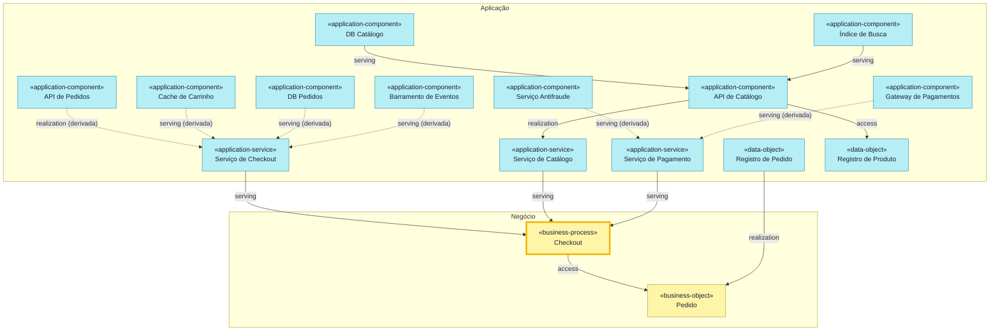
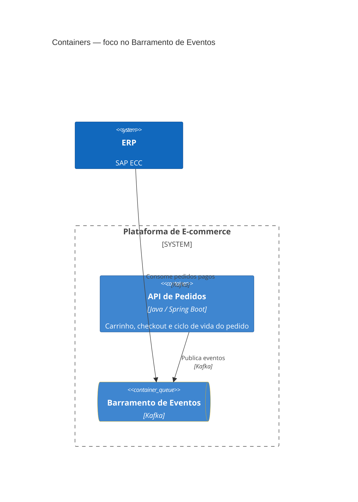

# Ensaio do archlens-ask — 2026-10-25

Respostas que um agente produziu **sozinho**, com o pacote atual (`INSTRUCTIONS.md`, `RULES.md`, `REFERENCE.md`,
`EXAMPLES.md`) como instruções e conhecimento, e acesso à base só pelas ferramentas de leitura do gbrain
(`gbrain call`, equivalente ao MCP) da demonstração `examples/loja-online-gbrain` (modo git, ligações tipadas). O
agente não leu o gabarito, a CLI nem os arquivos da base. O ensaio foi feito no Claude Code fazendo o papel do
assistente; a validação no M365 Copilot e no Claude Desktop é a do README.

## Resultado contra o gabarito

| Pergunta | Elementos | Relações (derivadas) | Chamadas ao gbrain |
|---|---|---|---|
| `suporte-processo` | 25/25 | 26/26 (6) | 69 |
| `impacto-container` | 32/32 | 41/41 (9) | 33 |
| `consumidores-evento` | 3/3 | 2/2 | 5 |
| `cartao` | igual ao cartão da CLI | — | 1 |
| `ambiguo` | listou 7 candidatos e perguntou | — | 2 |
| `grande` | 29/29 | 43/43 | 5 |

As contagens de chamadas reaproveitam páginas lidas nas perguntas anteriores (mesma conversa). Os três diagramas
renderizam no Mermaid 11.4.1.

## Lacunas apontadas pelo agente (abertas)

- `RULES.md` §10 (visão salva que é exatamente o pedido: desenhar inteira) × `EXAMPLES.md` exemplo 2 (oferece recortes):
  na pergunta de impacto, o agente seguiu o §10 e desenhou os 32 elementos.
- O fluxo manda procurar uma visão salva, mas não diz como listá-las: `list_pages {"type":"archlens-view"}` funciona e
  não está no `REFERENCE.md` (nem o tipo `archlens-changelog`).
- `resolve_slugs` devolve no máximo 5 slugs: risco de "não encontrado" ou de ambiguidade não detectada; `search` (só
  palavra-chave, até 20 resultados) mistura tipos e páginas de visão.
- Custo da travessia: ~2 chamadas por elemento (`get_page` + `get_backlinks`), sem orientação de custo fora do modo
  degradado.
- Semântica de `collapse` não explicada em `RULES.md`; campos do cartão (propriedades, rodadas do `changelog`) pouco
  especificados; seção dos sistemas externos no markdown C4; se o contexto da conversa desfaz uma ambiguidade.
- A seção "Contém" do corpo da página pai aparece nos backlinks do filho como `mentions` (não documentado).

---

Base: `archlens/manifest` "Loja Online" (formato `2.0`, única base). Modo de ligações: **com ligações tipadas** (os
filhos de `loja.pedidos` aparecem em `get_backlinks` como `part_of`).

## 1. suporte-processo — "Que aplicações e infraestrutura sustentam o processo de checkout?"

Recorte: `{"key":"suporte-checkout","notation":"archimate","viewpoint":"layered","anchor":"bp-checkout","traverse":{"mode":"supporters"},"granularity":"container","title":"Processo de Checkout — dependências por camada"}`

(Visão salva `suporte-checkout`, que é exatamente este pedido.)

# Processo de Checkout — dependências por camada

## Negócio

| Nome | Tipo | Status | Tecnologia |
|---|---|---|---|
| Checkout | business-process | active |  |
| Pedido | business-object | active |  |

## Aplicação

| Nome | Tipo | Status | Tecnologia |
|---|---|---|---|
| API de Pedidos | application-component (container) | active | Java / Spring Boot |
| API de Catálogo | application-component (container) | active | Go |
| Índice de Busca | application-component (container) | active | Elasticsearch |
| Cache de Carrinho | application-component (container) | active | Redis |
| DB Pedidos | application-component (container) | active | PostgreSQL |
| DB Catálogo | application-component (container) | active | MongoDB |
| Barramento de Eventos | application-component (container) | active | Kafka |
| Gateway de Pagamentos | application-component (softwareSystem) | active |  |
| Serviço Antifraude | application-component (softwareSystem) | active |  |
| Serviço de Checkout | application-service | active |  |
| Serviço de Catálogo | application-service | active |  |
| Serviço de Pagamento | application-service | active |  |
| Registro de Pedido | data-object | active |  |
| Registro de Produto | data-object | active |  |

## Tecnologia

| Nome | Tipo | Status | Tecnologia |
|---|---|---|---|
| Cluster Kubernetes (EKS) | node | active |  |
| Hospedagem de contêineres | technology-service | active |  |
| Mensageria | technology-service | active |  |
| PostgreSQL 16 (RDS) | system-software | active |  |
| MongoDB Atlas | system-software | active |  |
| Redis (ElastiCache) | system-software | active |  |
| Apache Kafka (MSK) | system-software | active |  |
| Elasticsearch | system-software | active |  |
| pedidos-api.jar | artifact | active |  |

## Relações

- Serviço de Checkout serve Checkout. (serving)
- Serviço de Catálogo serve Checkout. (serving)
- Serviço de Pagamento serve Checkout. (serving)
- Checkout grava Pedido. (access)
- Registro de Pedido realiza Pedido. (realization)
- API de Catálogo realiza Serviço de Catálogo. (realization)
- API de Catálogo lê e grava Registro de Produto. (access)
- DB Catálogo serve API de Catálogo — "Lê e grava produtos" [MongoDB wire]. (serving)
- Índice de Busca serve API de Catálogo — "Indexa produtos" [HTTP]. (serving)
- Hospedagem de contêineres serve API de Pedidos. (serving)
- Hospedagem de contêineres serve API de Catálogo. (serving)
- Cluster Kubernetes (EKS) realiza Hospedagem de contêineres. (realization)
- Apache Kafka (MSK) realiza Mensageria. (realization)
- Mensageria serve API de Pedidos. (serving)
- PostgreSQL 16 (RDS) serve API de Pedidos. (serving)
- Redis (ElastiCache) serve API de Pedidos. (serving)
- MongoDB Atlas serve API de Catálogo. (serving)
- Elasticsearch serve API de Catálogo. (serving)
- pedidos-api.jar realiza API de Pedidos. (realization)
- Cluster Kubernetes (EKS) hospeda pedidos-api.jar. (assignment)
- API de Pedidos realiza Serviço de Checkout. (realization, derivada via Checkout Controller)
- Serviço Antifraude serve Serviço de Pagamento. (serving, derivada via Pagamento Adapter)
- Gateway de Pagamentos serve Serviço de Pagamento. (serving, derivada via Pagamento Adapter)
- Cache de Carrinho serve Serviço de Checkout. (serving, derivada via Carrinho Service, Checkout Controller)
- DB Pedidos serve Serviço de Checkout. (serving, derivada via Pedido Repository, Checkout Controller)
- Barramento de Eventos serve Serviço de Checkout. (serving, derivada via Publicador de Eventos, Checkout Controller)

São 25 elementos, um pouco acima do limite de leitura (~24). O diagrama abaixo mostra negócio e aplicação (16
elementos); os 9 de tecnologia estão na tabela acima.

Ficou de fora: os componentes da API de Pedidos (Checkout Controller, Carrinho Service, Pagamento Adapter, Pedido
Repository, Publicador de Eventos), escondidos pela granularidade `container` e representados pelas relações
derivadas; e o sistema Plataforma de E-commerce, escondido porque os containers dele já estão na visão. Para ver os
componentes, peça o mesmo recorte com `granularity:"component"`.

_Chamadas ao gbrain: 69_

## 2. impacto-container — "O que é impactado se a API de Pedidos cair?"

Recorte: `{"key":"impacto-api-pedidos","notation":"archimate","viewpoint":"impact","anchor":"loja.pedidos","traverse":{"mode":"both"},"output":["diagram","matrix"],"title":"API de Pedidos — matriz de dependência e impacto"}`

(Visão salva `impacto-api-pedidos`, que é exatamente este pedido. Modo `both`: lista o que **depende** da API — o
que é impactado se ela cair — e o que a **sustenta**.)

# API de Pedidos — matriz de dependência e impacto

## Motivação

| Nome | Tipo | Status | Tecnologia |
|---|---|---|---|
| Checkout < 2s (p95) | requirement | active |  |
| Reduzir abandono de carrinho | goal | active |  |

## Negócio

| Nome | Tipo | Status | Tecnologia |
|---|---|---|---|
| Atendente SAC | business-actor (person) | active |  |
| Cliente | business-actor (person) | active |  |
| Comprador | business-role (person) | active |  |
| Tratar solicitação | business-process | active |  |
| Checkout | business-process | active |  |
| Atendimento pós-venda | business-service | active |  |
| Compra online | business-service | active |  |
| Pagamento seguro | business-service | active |  |
| Venda Online | product | active |  |

## Aplicação

| Nome | Tipo | Status | Tecnologia |
|---|---|---|---|
| API de Pedidos | application-component (container) | active | Java / Spring Boot |
| BFF | application-component (container) | active | Node.js / GraphQL |
| Web Storefront | application-component (container) | active | Next.js |
| App Mobile | application-component (container) | active | React Native |
| Cache de Carrinho | application-component (container) | active | Redis |
| DB Pedidos | application-component (container) | active | PostgreSQL |
| Barramento de Eventos | application-component (container) | active | Kafka |
| CRM | application-component (softwareSystem) | active |  |
| Gateway de Pagamentos | application-component (softwareSystem) | active |  |
| Serviço Antifraude | application-component (softwareSystem) | active |  |
| Consulta de Pedidos | application-service | active |  |
| Serviço de Checkout | application-service | active |  |
| Serviço de Pagamento | application-service | active |  |
| Registro de Pedido | data-object | active |  |

## Tecnologia

| Nome | Tipo | Status | Tecnologia |
|---|---|---|---|
| Hospedagem de contêineres | technology-service | active |  |
| Mensageria | technology-service | active |  |
| Cluster Kubernetes (EKS) | node | active |  |
| PostgreSQL 16 (RDS) | system-software | active |  |
| Redis (ElastiCache) | system-software | active |  |
| Apache Kafka (MSK) | system-software | active |  |
| pedidos-api.jar | artifact | active |  |

## Relações

- API de Pedidos serve CRM — "Consulta pedidos" [REST]. (serving)
- API de Pedidos realiza Consulta de Pedidos. (realization)
- API de Pedidos atende a Checkout < 2s (p95). (realization)
- Checkout < 2s (p95) influencia Reduzir abandono de carrinho. (influence)
- CRM serve Atendente SAC — "Atende clientes". (serving)
- CRM serve Tratar solicitação. (serving)
- Consulta de Pedidos serve Tratar solicitação. (serving)
- Atendente SAC executa Tratar solicitação. (assignment)
- Tratar solicitação realiza Atendimento pós-venda. (realization)
- Venda Online agrega Compra online. (aggregation)
- Venda Online agrega Pagamento seguro. (aggregation)
- Venda Online agrega Atendimento pós-venda. (aggregation)
- Serviço de Checkout serve Checkout. (serving)
- Serviço de Pagamento serve Checkout. (serving)
- Checkout realiza Compra online. (realization)
- Checkout realiza Pagamento seguro. (realization)
- Checkout realiza Reduzir abandono de carrinho. (realization)
- Compra online serve Comprador. (serving)
- Cliente desempenha Comprador. (assignment)
- BFF serve Web Storefront — "Consulta e envia pedidos" [GraphQL]. (serving)
- BFF serve App Mobile — "Consulta e envia pedidos" [GraphQL]. (serving)
- Web Storefront serve Cliente — "Navega e compra" [HTTPS]. (serving)
- App Mobile serve Cliente — "Compra pelo celular" [HTTPS]. (serving)
- pedidos-api.jar realiza API de Pedidos. (realization)
- Cluster Kubernetes (EKS) hospeda pedidos-api.jar. (assignment)
- Cluster Kubernetes (EKS) realiza Hospedagem de contêineres. (realization)
- Apache Kafka (MSK) realiza Mensageria. (realization)
- Hospedagem de contêineres serve API de Pedidos. (serving)
- Hospedagem de contêineres serve BFF. (serving)
- Mensageria serve API de Pedidos. (serving)
- PostgreSQL 16 (RDS) serve API de Pedidos. (serving)
- Redis (ElastiCache) serve API de Pedidos. (serving)
- API de Pedidos serve BFF. (serving, derivada via Checkout Controller)
- API de Pedidos realiza Serviço de Checkout. (realization, derivada via Checkout Controller)
- API de Pedidos realiza Serviço de Pagamento. (realization, derivada via Pagamento Adapter)
- API de Pedidos grava Registro de Pedido. (access, derivada via Pedido Repository)
- Cache de Carrinho serve API de Pedidos. (serving, derivada via Carrinho Service)
- DB Pedidos serve API de Pedidos. (serving, derivada via Pedido Repository)
- Barramento de Eventos serve API de Pedidos. (serving, derivada via Publicador de Eventos)
- Gateway de Pagamentos serve API de Pedidos. (serving, derivada via Pagamento Adapter)
- Serviço Antifraude serve API de Pedidos. (serving, derivada via Pagamento Adapter)

## Matriz de dependência

| Elemento | Tipo | Camada | Relação | Dist. | Caminho |
|---|---|---|---|---|---|
| Checkout < 2s (p95) | Requirement | Motivação | depende da âncora | 1 | realization → Checkout < 2s (p95) |
| Reduzir abandono de carrinho | Goal | Motivação | depende da âncora | 2 | realization → Checkout < 2s (p95) · influence → Reduzir abandono de carrinho |
| Atendente SAC | Business Actor | Negócio | depende da âncora | 2 | serving → CRM · serving → Atendente SAC |
| Tratar solicitação | Business Process | Negócio | depende da âncora | 2 | serving → CRM · serving → Tratar solicitação |
| Atendimento pós-venda | Business Service | Negócio | depende da âncora | 3 | serving → CRM · serving → Tratar solicitação · realization → Atendimento pós-venda |
| Checkout | Business Process | Negócio | depende da âncora | 3 | composition → Checkout Controller · realization → Serviço de Checkout · serving → Checkout |
| Venda Online | Product | Negócio | depende da âncora | 4 | serving → CRM · serving → Tratar solicitação · realization → Atendimento pós-venda · aggregation → Venda Online |
| Compra online | Business Service | Negócio | depende da âncora | 4 | composition → Checkout Controller · realization → Serviço de Checkout · serving → Checkout · realization → Compra online |
| Pagamento seguro | Business Service | Negócio | depende da âncora | 4 | composition → Checkout Controller · realization → Serviço de Checkout · serving → Checkout · realization → Pagamento seguro |
| Cliente | Business Actor | Negócio | depende da âncora | 4 | composition → Checkout Controller · serving → BFF · serving → Web Storefront · serving → Cliente |
| Comprador | Business Role | Negócio | depende da âncora | 5 | composition → Checkout Controller · realization → Serviço de Checkout · serving → Checkout · realization → Compra online · serving → Comprador |
| CRM | Application Component | Aplicação | depende da âncora | 1 | serving → CRM |
| Consulta de Pedidos | Application Service | Aplicação | depende da âncora | 1 | realization → Consulta de Pedidos |
| BFF | Application Component | Aplicação | depende da âncora | 2 | composition → Checkout Controller · serving → BFF |
| Serviço de Checkout | Application Service | Aplicação | depende da âncora | 2 | composition → Checkout Controller · realization → Serviço de Checkout |
| Serviço de Pagamento | Application Service | Aplicação | depende da âncora | 2 | composition → Pagamento Adapter · realization → Serviço de Pagamento |
| Web Storefront | Application Component | Aplicação | depende da âncora | 3 | composition → Checkout Controller · serving → BFF · serving → Web Storefront |
| App Mobile | Application Component | Aplicação | depende da âncora | 3 | composition → Checkout Controller · serving → BFF · serving → App Mobile |
| Plataforma de E-commerce (oculto na visão) | Application Component | Aplicação | ambos | 1 | composition → Plataforma de E-commerce |
| Checkout Controller (oculto na visão) | Application Component | Aplicação | ambos | 1 | composition → Checkout Controller |
| Carrinho Service (oculto na visão) | Application Component | Aplicação | ambos | 1 | composition → Carrinho Service |
| Pagamento Adapter (oculto na visão) | Application Component | Aplicação | ambos | 1 | composition → Pagamento Adapter |
| Pedido Repository (oculto na visão) | Application Component | Aplicação | ambos | 1 | composition → Pedido Repository |
| Publicador de Eventos (oculto na visão) | Application Component | Aplicação | ambos | 1 | composition → Publicador de Eventos |
| Cache de Carrinho | Application Component | Aplicação | sustenta a âncora | 2 | composition → Carrinho Service · serving → Cache de Carrinho |
| DB Pedidos | Application Component | Aplicação | sustenta a âncora | 2 | composition → Pedido Repository · serving → DB Pedidos |
| Barramento de Eventos | Application Component | Aplicação | sustenta a âncora | 2 | composition → Publicador de Eventos · serving → Barramento de Eventos |
| Gateway de Pagamentos | Application Component | Aplicação | sustenta a âncora | 2 | composition → Pagamento Adapter · serving → Gateway de Pagamentos |
| Serviço Antifraude | Application Component | Aplicação | sustenta a âncora | 2 | composition → Pagamento Adapter · serving → Serviço Antifraude |
| Registro de Pedido | Data Object | Aplicação | sustenta a âncora | 2 | composition → Pedido Repository · access → Registro de Pedido |
| pedidos-api.jar | Artifact | Tecnologia | sustenta a âncora | 1 | realization → pedidos-api.jar |
| Hospedagem de contêineres | Technology Service | Tecnologia | sustenta a âncora | 1 | serving → Hospedagem de contêineres |
| Mensageria | Technology Service | Tecnologia | sustenta a âncora | 1 | serving → Mensageria |
| PostgreSQL 16 (RDS) | System Software | Tecnologia | sustenta a âncora | 1 | serving → PostgreSQL 16 (RDS) |
| Redis (ElastiCache) | System Software | Tecnologia | sustenta a âncora | 1 | serving → Redis (ElastiCache) |
| Cluster Kubernetes (EKS) | Node | Tecnologia | sustenta a âncora | 2 | serving → Hospedagem de contêineres · realization → Cluster Kubernetes (EKS) |
| Apache Kafka (MSK) | System Software | Tecnologia | sustenta a âncora | 2 | serving → Mensageria · realization → Apache Kafka (MSK) |

**Em resumo, se a API de Pedidos cair:** param o CRM (consulta de pedidos) e com ele o atendimento (Atendente SAC,
Tratar solicitação, Atendimento pós-venda); o BFF perde carrinho e fechamento de pedido, o que atinge Web
Storefront, App Mobile e o Cliente; o processo de Checkout perde os serviços de Checkout e de Pagamento, e com ele os
serviços de negócio Compra online e Pagamento seguro, o papel Comprador e a oferta Venda Online; o requisito
"Checkout < 2s (p95)" e a meta "Reduzir abandono de carrinho" ficam comprometidos. As linhas "sustenta a âncora" são o
que a API precisa para funcionar (não são impactadas pela queda dela).

São 32 elementos, acima do limite de leitura (~24). Como esta é a visão salva `impacto-api-pedidos`, o diagrama vem
inteiro. Para um diagrama mais legível, peça só o que **depende** da API (`traverse.mode:"dependents"`, negócio e
aplicação) ou só o que ela **precisa** (`traverse.mode:"supporters"`, aplicação e tecnologia).

```mermaid
flowchart TB
  classDef motivation fill:#dcd6ff,stroke:#6f62c9,color:#18202c
  classDef business fill:#fff5a8,stroke:#a89a2c,color:#18202c
  classDef application fill:#b6eef6,stroke:#338fa0,color:#18202c
  classDef technology fill:#cbe8b9,stroke:#558f42,color:#18202c
  classDef anchor stroke:#f2b705,stroke-width:4px

  subgraph L_motivation["Motivação"]
    req_latencia["«requirement»<br/>Checkout < 2s (p95)"]:::motivation
    goal_abandono["«goal»<br/>Reduzir abandono de carrinho"]:::motivation
  end
  subgraph L_business["Negócio"]
    atendente["«business-actor»<br/>Atendente SAC"]:::business
    cliente["«business-actor»<br/>Cliente"]:::business
    br_comprador["«business-role»<br/>Comprador"]:::business
    bp_atendimento["«business-process»<br/>Tratar solicitação"]:::business
    bp_checkout["«business-process»<br/>Checkout"]:::business
    bs_atendimento["«business-service»<br/>Atendimento pós-venda"]:::business
    bs_compra["«business-service»<br/>Compra online"]:::business
    bs_pagamento["«business-service»<br/>Pagamento seguro"]:::business
    prod_venda["«product»<br/>Venda Online"]:::business
  end
  subgraph L_application["Aplicação"]
    loja_pedidos["«application-component»<br/>API de Pedidos"]:::application
    loja_bff["«application-component»<br/>BFF"]:::application
    loja_web["«application-component»<br/>Web Storefront"]:::application
    loja_app["«application-component»<br/>App Mobile"]:::application
    loja_cache["«application-component»<br/>Cache de Carrinho"]:::application
    loja_db_pedidos["«application-component»<br/>DB Pedidos"]:::application
    loja_eventos["«application-component»<br/>Barramento de Eventos"]:::application
    crm["«application-component»<br/>CRM"]:::application
    gateway["«application-component»<br/>Gateway de Pagamentos"]:::application
    antifraude["«application-component»<br/>Serviço Antifraude"]:::application
    as_consulta["«application-service»<br/>Consulta de Pedidos"]:::application
    as_checkout["«application-service»<br/>Serviço de Checkout"]:::application
    as_pagamento["«application-service»<br/>Serviço de Pagamento"]:::application
    do_pedido["«data-object»<br/>Registro de Pedido"]:::application
  end
  subgraph L_technology["Tecnologia"]
    ts_hosting["«technology-service»<br/>Hospedagem de contêineres"]:::technology
    ts_mensageria["«technology-service»<br/>Mensageria"]:::technology
    tn_k8s["«node»<br/>Cluster Kubernetes (EKS)"]:::technology
    ss_postgres["«system-software»<br/>PostgreSQL 16 (RDS)"]:::technology
    ss_redis["«system-software»<br/>Redis (ElastiCache)"]:::technology
    ss_kafka["«system-software»<br/>Apache Kafka (MSK)"]:::technology
    art_pedidos["«artifact»<br/>pedidos-api.jar"]:::technology
  end

  loja_pedidos -->|"serving"| crm
  loja_pedidos -->|"realization"| as_consulta
  loja_pedidos -->|"realization"| req_latencia
  req_latencia -->|"influence"| goal_abandono
  crm -->|"serving"| atendente
  crm -->|"serving"| bp_atendimento
  as_consulta -->|"serving"| bp_atendimento
  atendente -->|"assignment"| bp_atendimento
  bp_atendimento -->|"realization"| bs_atendimento
  prod_venda -->|"aggregation"| bs_compra
  prod_venda -->|"aggregation"| bs_pagamento
  prod_venda -->|"aggregation"| bs_atendimento
  as_checkout -->|"serving"| bp_checkout
  as_pagamento -->|"serving"| bp_checkout
  bp_checkout -->|"realization"| bs_compra
  bp_checkout -->|"realization"| bs_pagamento
  bp_checkout -->|"realization"| goal_abandono
  bs_compra -->|"serving"| br_comprador
  cliente -->|"assignment"| br_comprador
  loja_bff -->|"serving"| loja_web
  loja_bff -->|"serving"| loja_app
  loja_web -->|"serving"| cliente
  loja_app -->|"serving"| cliente
  art_pedidos -->|"realization"| loja_pedidos
  tn_k8s -->|"assignment"| art_pedidos
  tn_k8s -->|"realization"| ts_hosting
  ss_kafka -->|"realization"| ts_mensageria
  ts_hosting -->|"serving"| loja_pedidos
  ts_hosting -->|"serving"| loja_bff
  ts_mensageria -->|"serving"| loja_pedidos
  ss_postgres -->|"serving"| loja_pedidos
  ss_redis -->|"serving"| loja_pedidos
  loja_pedidos -.->|"serving (derivada)"| loja_bff
  loja_pedidos -.->|"realization (derivada)"| as_checkout
  loja_pedidos -.->|"realization (derivada)"| as_pagamento
  loja_pedidos -.->|"access (derivada)"| do_pedido
  loja_cache -.->|"serving (derivada)"| loja_pedidos
  loja_db_pedidos -.->|"serving (derivada)"| loja_pedidos
  loja_eventos -.->|"serving (derivada)"| loja_pedidos
  gateway -.->|"serving (derivada)"| loja_pedidos
  antifraude -.->|"serving (derivada)"| loja_pedidos
  class loja_pedidos anchor
```

Ficou de fora da visão (mas está na matriz): os cinco componentes da API de Pedidos (granularidade `container`) e o
sistema Plataforma de E-commerce (os containers dele já estão na visão). Relações de disparo (`triggering`, ex.:
Checkout dispara Faturamento) não entram na travessia de impacto; peça se quiser seguir o fluxo de processos.

_Chamadas ao gbrain: 33_

## 3. consumidores-evento — "Quem publica e quem consome o barramento de eventos da loja?"

Recorte: `{"notation":"c4","level":"container","scope":"loja","focus":["loja.eventos"],"depth":1,"title":"Containers — foco no Barramento de Eventos"}`

# Containers — foco no Barramento de Eventos

## Containers (Plataforma de E-commerce)

| Nome | Tipo | Status | Tecnologia |
|---|---|---|---|
| Barramento de Eventos | application-component (container) | active | Kafka |
| API de Pedidos | application-component (container) | active | Java / Spring Boot |

## Sistemas

| Nome | Tipo | Status | Tecnologia |
|---|---|---|---|
| ERP | application-component (softwareSystem) | active | SAP ECC |

## Relações

- **Publica:** API de Pedidos publica no Barramento de Eventos — "Publica eventos" [Kafka]. Na base, é o componente
  Publicador de Eventos (Kafka client), dentro da API de Pedidos, que recebe o serviço do barramento; no C4 a seta
  sobe para o container. (serving Barramento de Eventos → Publicador de Eventos, invertida para "usa" e elevada)
- **Consome:** ERP consome do Barramento de Eventos — "Consome pedidos pagos" [Kafka]. (serving Barramento de
  Eventos → ERP, invertida para "usa")

Atenção: a base liga o barramento aos dois lados com o mesmo tipo (`serving`, do barramento para quem o usa). O papel
de cada um vem só da descrição da relação ("Publica eventos", "Consome pedidos pagos"). A base não diz quais eventos
a API publica além de, dentro dela, o Publicador de Eventos servir o Checkout Controller com "Publica PedidoCriado".

Ficou de fora: a infraestrutura, que não aparece no C4 — o serviço de tecnologia Mensageria (realizado por Apache
Kafka (MSK)) serve tanto a API de Pedidos quanto o ERP. Não há outro publicador nem consumidor do barramento na base.

_Chamadas ao gbrain: 5_

## 4. cartao — "Me fale da API de Pedidos."

Recorte: cartão do elemento `loja.pedidos`

# API de Pedidos

- Id: `loja.pedidos`
- Tipo: application-component (perfil C4: container)
- Status: active
- Tecnologia: Java / Spring Boot
- Apelidos: API de Pedidos

Carrinho, checkout e ciclo de vida do pedido

Pai: Plataforma de E-commerce (`loja`)

## Filhos

- Checkout Controller (`loja.pedidos.checkout`) — component, Spring MVC
- Carrinho Service (`loja.pedidos.carrinho`) — component, Spring Bean
- Pagamento Adapter (`loja.pedidos.pagamento`) — component, Spring Bean
- Pedido Repository (`loja.pedidos.repo`) — component, Spring Data JPA
- Publicador de Eventos (`loja.pedidos.eventos`) — component, Kafka client

## Relações de saída

### realization

- API de Pedidos realiza Consulta de Pedidos.
- API de Pedidos atende a Checkout < 2s (p95).

### serving

- API de Pedidos serve CRM — "Consulta pedidos". [REST]

## Relações de entrada

### realization

- pedidos-api.jar realiza API de Pedidos.

### serving

- PostgreSQL 16 (RDS) serve API de Pedidos.
- Redis (ElastiCache) serve API de Pedidos.
- Hospedagem de contêineres serve API de Pedidos.
- Mensageria serve API de Pedidos.

## Propriedades e fontes

Sem propriedades nem fontes (`sources`) registradas na página.

## Histórico

Nenhuma rodada do `archlens/changelog` cita `loja.pedidos` (a única rodada, 2026-10-02-01 "Plataformas de vendas e
de back-office", alterou outros elementos).

Os componentes têm relações próprias (ex.: Pagamento Adapter usa Gateway de Pagamentos e Serviço Antifraude; Pedido
Repository usa DB Pedidos), que não estão no cartão; peça "componentes da API de Pedidos" para vê-las.

_Chamadas ao gbrain: 1_

## 5. ambiguo — "Me fale de pedidos."

"Pedidos" bate com vários elementos da base. Qual deles?

1. **API de Pedidos** (`loja.pedidos`) — application-component, container, Java / Spring Boot
2. **Pedido** (`bo-pedido`) — business-object
3. **Registro de Pedido** (`do-pedido`) — data-object
4. **DB Pedidos** (`loja.db-pedidos`) — application-component, container, PostgreSQL
5. **Pedido Repository** (`loja.pedidos.repo`) — application-component, componente da API de Pedidos
6. **Consulta de Pedidos** (`as-consulta`) — application-service
7. **Entrega do pedido** (`bs-entrega`) — business-service

(Se for a API de Pedidos, o cartão é o da resposta anterior.)

_Chamadas ao gbrain: 2_

## 6. grande — "Mostre toda a camada de aplicação com componentes."

Recorte: `{"notation":"archimate","viewpoint":"application","granularity":"component","title":"Camada de Aplicação (com componentes)"}`

(Ajuste da visão salva `aplicacao`, "Camada de Aplicação (sistemas e containers)", que usa `granularity:"container"`;
aqui a granularidade é `component`, a pedido.)

# Camada de Aplicação (com componentes)

## Aplicação

| Nome | Tipo | Status | Tecnologia |
|---|---|---|---|
| Plataforma de E-commerce | application-component (softwareSystem) | active |  |
| ERP | application-component (softwareSystem) | active | SAP ECC |
| CRM | application-component (softwareSystem) | active |  |
| Gateway de Pagamentos | application-component (softwareSystem) | active |  |
| Serviço Antifraude | application-component (softwareSystem) | active |  |
| API da Transportadora | application-component (softwareSystem) | active |  |
| Web Storefront | application-component (container) | active | Next.js |
| App Mobile | application-component (container) | active | React Native |
| BFF | application-component (container) | active | Node.js / GraphQL |
| API de Pedidos | application-component (container) | active | Java / Spring Boot |
| API de Catálogo | application-component (container) | active | Go |
| Índice de Busca | application-component (container) | active | Elasticsearch |
| Cache de Carrinho | application-component (container) | active | Redis |
| DB Pedidos | application-component (container) | active | PostgreSQL |
| DB Catálogo | application-component (container) | active | MongoDB |
| Barramento de Eventos | application-component (container) | active | Kafka |
| Checkout Controller | application-component (component) | active | Spring MVC |
| Carrinho Service | application-component (component) | active | Spring Bean |
| Pagamento Adapter | application-component (component) | active | Spring Bean |
| Pedido Repository | application-component (component) | active | Spring Data JPA |
| Publicador de Eventos | application-component (component) | active | Kafka client |
| Serviço de Catálogo | application-service | active |  |
| Serviço de Checkout | application-service | active |  |
| Serviço de Pagamento | application-service | active |  |
| Consulta de Pedidos | application-service | active |  |
| Serviço de Faturamento | application-service | active |  |
| Serviço de Logística | application-service | active |  |
| Registro de Pedido | data-object | active |  |
| Registro de Produto | data-object | active |  |

## Relações

- Plataforma de E-commerce contém Web Storefront, App Mobile, BFF, API de Pedidos, API de Catálogo, Índice de Busca,
  Cache de Carrinho, DB Pedidos, DB Catálogo e Barramento de Eventos. (composition, pela hierarquia — 10 relações)
- API de Pedidos contém Checkout Controller, Carrinho Service, Pagamento Adapter, Pedido Repository e Publicador de
  Eventos. (composition, pela hierarquia — 5 relações)
- BFF serve Web Storefront — "Consulta e envia pedidos" [GraphQL]. (serving)
- BFF serve App Mobile — "Consulta e envia pedidos" [GraphQL]. (serving)
- Índice de Busca serve BFF — "Busca textual" [HTTP]. (serving)
- Índice de Busca serve API de Catálogo — "Indexa produtos" [HTTP]. (serving)
- API de Catálogo serve BFF — "Consulta produtos" [REST]. (serving)
- API de Catálogo realiza Serviço de Catálogo. (realization)
- API de Catálogo lê e grava Registro de Produto. (access)
- DB Catálogo serve API de Catálogo — "Lê e grava produtos" [MongoDB wire]. (serving)
- Carrinho Service serve BFF — "Gerencia carrinho" [REST]. (serving)
- Carrinho Service serve Checkout Controller — "Obtém itens". (serving)
- Cache de Carrinho serve Carrinho Service — "Lê e grava carrinho" [RESP]. (serving)
- Checkout Controller serve BFF — "Fecha pedido" [REST]. (serving)
- Checkout Controller realiza Serviço de Checkout. (realization)
- Pagamento Adapter serve Checkout Controller — "Solicita autorização". (serving)
- Pagamento Adapter realiza Serviço de Pagamento. (realization)
- Gateway de Pagamentos serve Pagamento Adapter — "Autoriza pagamento" [HTTPS]. (serving)
- Serviço Antifraude serve Pagamento Adapter — "Avalia risco" [HTTPS]. (serving)
- Pedido Repository serve Checkout Controller — "Persiste pedido". (serving)
- Pedido Repository grava Registro de Pedido. (access)
- DB Pedidos serve Pedido Repository — "Lê e grava pedidos" [JDBC]. (serving)
- Publicador de Eventos serve Checkout Controller — "Publica PedidoCriado". (serving)
- Barramento de Eventos serve Publicador de Eventos — "Publica eventos" [Kafka]. (serving)
- Barramento de Eventos serve ERP — "Consome pedidos pagos" [Kafka]. (serving)
- API de Pedidos serve CRM — "Consulta pedidos" [REST]. (serving)
- API de Pedidos realiza Consulta de Pedidos. (realization)
- ERP realiza Serviço de Faturamento. (realization)
- ERP realiza Serviço de Logística. (realization)
- API da Transportadora serve ERP — "Solicita coleta" [REST]. (serving)

São 29 elementos e 43 relações, acima do limite de leitura de um diagrama (~24 elementos), e o pedido é a camada
inteira, sem um recorte óbvio. Por isso não desenhei. Qual destes diagramas você prefere?

1. **Sem os componentes** — a visão salva "Camada de Aplicação (sistemas e containers)"
   (`{"key":"aplicacao","notation":"archimate","viewpoint":"application","granularity":"container"}`): 23 elementos.
2. **Com os componentes, sem os serviços de aplicação** —
   `{"notation":"archimate","viewpoint":"application","granularity":"component","collapse":["application-service"]}`:
   23 elementos.
3. **Só a API de Pedidos por dentro** — a visão salva "Componentes — API de Pedidos" (C4, componentes do container
   `loja.pedidos` e seus vizinhos).

_Chamadas ao gbrain: 5_
